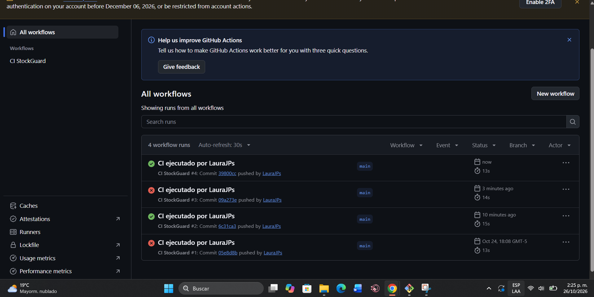
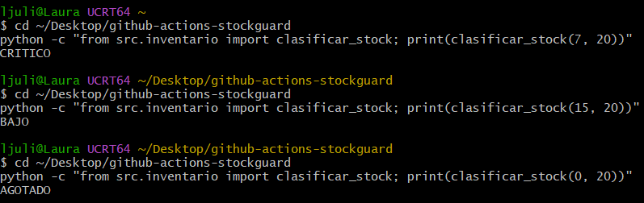
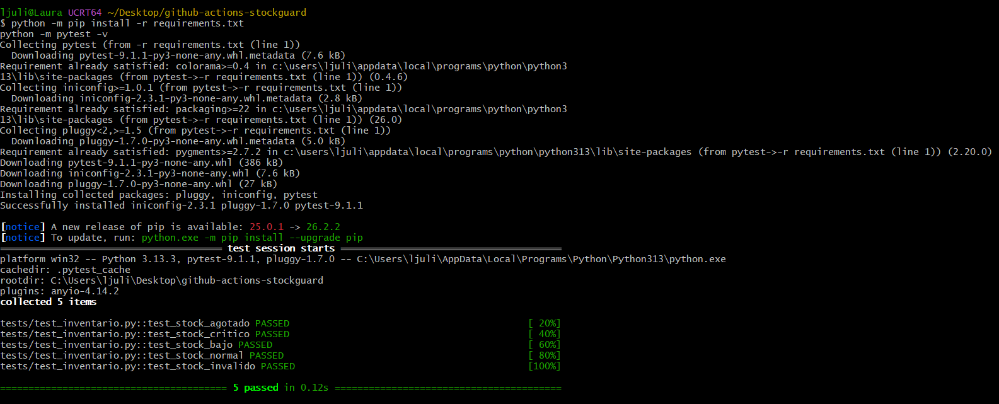
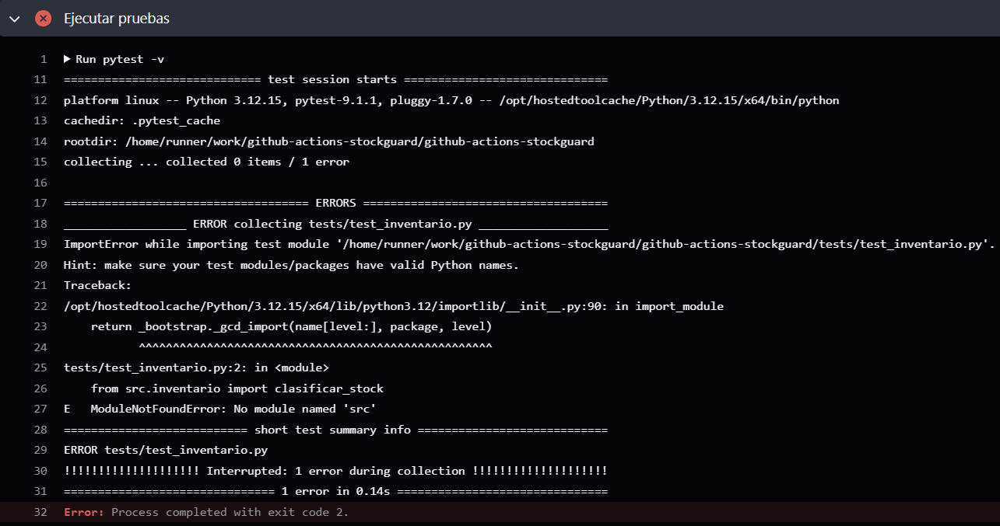
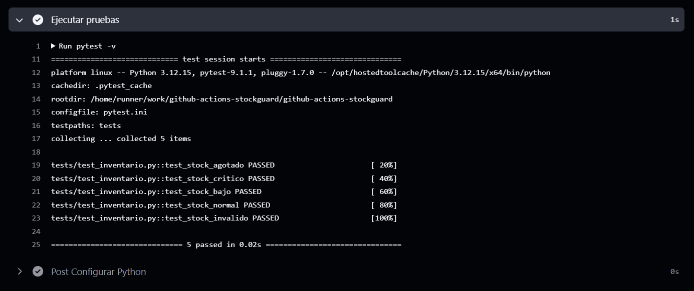
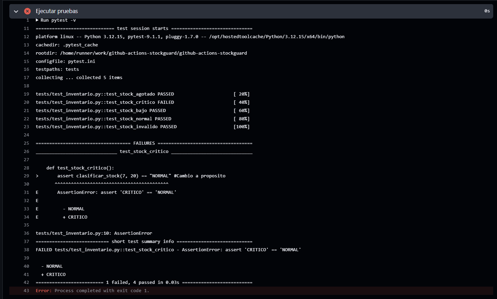
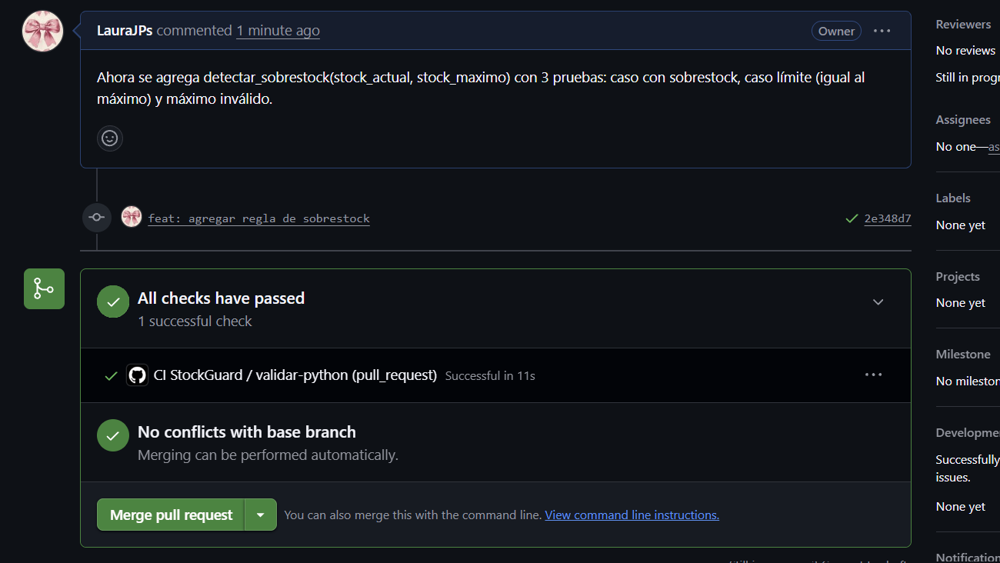
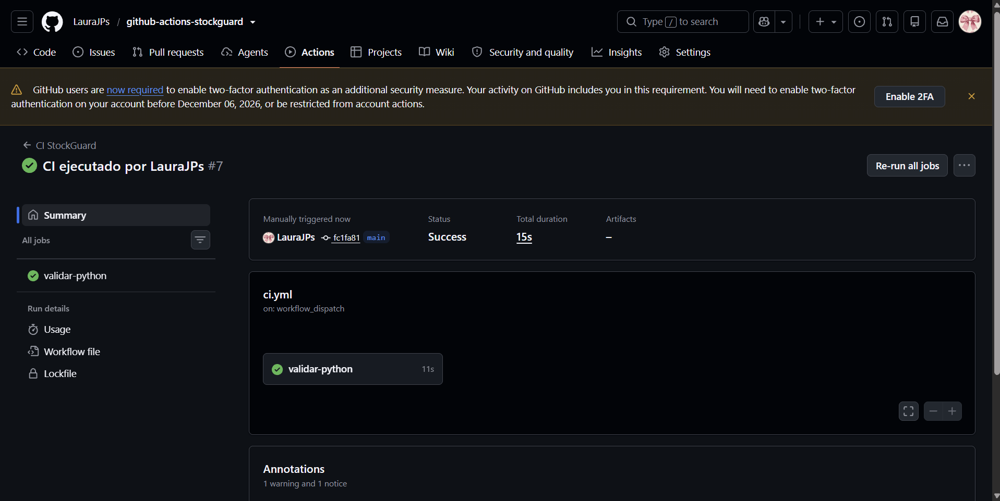

# Taller GitHub Actions – Evidencias y respuestas

**Estudiante:** Laura Posada (@LauraJPs) · Línea de Profundización I – Big Data
**Repositorio:** https://github.com/LauraJPs/github-actions-stockguard

## 1. Historial de ejecuciones del workflow `CI StockGuard`

| Run | Evento | Commit | Resultado | Qué pasó |
|---|---|---|---|---|
| #1 | push a `main` | `05e8d8b` chore: estructura inicial | ❌ | Fallo **real**: pytest no encontró el paquete `src` en el runner |
| #2 | push a `main` | `6c31ca3` ci: configurar pytest… | ✅ | Se agregó `pytest.ini` (`pythonpath = .`) y `.gitignore` |
| #3 | push a `main` | `09a273e` test: provocar fallo controlado | ❌ | Fallo **intencional**: la prueba esperaba `NORMAL` para (7, 20) |
| #4 | push a `main` | `39800cc` test: restaurar prueba correcta | ✅ | Se restauró la prueba |
| PR #1 | pull_request | `2e348d7` feat: agregar regla de sobrestock | ✅ | Check `validar-python (pull_request)` antes del merge |
| #7 | workflow_dispatch | `fc1fa81` (main) | ✅ | Ejecución manual disparada por LauraJPs |



## 2. Paso 2 – Prueba manual de la regla

Antes de automatizar comprobé la regla: con mínimo 20 y 7 unidades el resultado es **CRITICO**, porque 7 ≤ 50 % de 20 (10). Con 15 da **BAJO** (15 ≤ 20 pero > 10) y con 0 da **AGOTADO**.




## 3. Paso 5 – Primera ejecución y fallo real (Run #1)

La primera ejecución falló aunque localmente las 5 pruebas pasaban. Localmente usé `python -m pytest`, que agrega la carpeta actual al `sys.path`; en el runner el workflow ejecuta `pytest -v`, que no la agrega, y por eso no encontraba `src`.

```
E   ModuleNotFoundError: No module named 'src'
collected 0 items / 1 error
Error: Process completed with exit code 2.
```

**Corrección:** agregué `pytest.ini` con `pythonpath = .` y `testpaths = tests`, y un `.gitignore` para no subir `__pycache__` (se habían subido por error en el primer commit).




## 4. Paso 6 – Fallo controlado (Run #3)

Cambié a propósito `test_stock_critico` para que esperara `"NORMAL"`.



**¿Qué step falló?**
El step **"Ejecutar pruebas"** (`pytest -v`) del job `validar-python`.

**¿Qué mensaje produjo pytest?**
`FAILED tests/test_inventario.py::test_stock_critico - AssertionError: assert 'CRITICO' == 'NORMAL'`. Al final, `1 failed, 4 passed` y `exit code 1`. La función devolvió `CRITICO` (lo correcto) y la prueba esperaba `NORMAL`, así que el error estaba en la prueba, no en la función.

**¿Los steps anteriores habían terminado bien?**
Sí. *Descargar repositorio*, *Configurar Python*, *Instalar dependencias* y *Validar sintaxis* quedaron en verde. El código era válido; solo falló la verificación de la regla de negocio.

**¿Qué diferencia visual hay con la ejecución anterior?**
La ejecución aparece con una ❌ roja en la lista de Actions en lugar del ✓ verde, el step *Ejecutar pruebas* queda marcado en rojo y su log muestra la sección `FAILURES` con la línea exacta (`tests/test_inventario.py:10`) y la diferencia `- NORMAL / + CRITICO`. Comparado con el Run #1, este sí recolectó las 5 pruebas (`collected 5 items`) y corrió 4 con éxito; el Run #1 se detuvo antes, al importar.

Después restauré la prueba y el Run #4 volvió a pasar.

## 5. Paso 7 – Mejora propia y Pull Request

**PR:** https://github.com/LauraJPs/github-actions-stockguard/pull/1 (rama `feature/alerta-sobrestock`)

Agregué `detectar_sobrestock(stock_actual, stock_maximo)`, que indica si un producto supera la capacidad máxima de bodega, con 3 pruebas:
- `test_sobrestock_detectado`: 120 con máximo 100 → `True`.
- `test_sin_sobrestock_en_el_limite`: 100 con máximo 100 → `False` (caso límite).
- `test_sobrestock_maximo_invalido`: máximo 0 → `ValueError`.

El evento `pull_request` ejecutó el workflow antes del merge: **"All checks have passed – CI StockGuard / validar-python (pull_request) Successful in 11s"**.



## 6. Paso 8 – Ejecución manual (Run #7)

Desde *Actions → CI StockGuard → Run workflow*. El resumen muestra **"Manually triggered"** por **LauraJPs**, `on: workflow_dispatch`, sobre el commit `fc1fa81` de `main`, con estado **Success**.



## 7. Preguntas de análisis

**1. Identifica una ejecución exitosa y una fallida. ¿Qué commit produjo cada una y qué step determinó el resultado?**
La fallida es el Run #3, del commit `09a273e` ("test: provocar fallo controlado de CI"). El step que determinó el resultado fue *Ejecutar pruebas*, porque `test_stock_critico` falló. La exitosa es el Run #4, del commit `39800cc` ("test: restaurar prueba correcta"). Ahí el mismo step terminó con `5 passed` y todos los steps quedaron en verde. También tuve un fallo no planeado, el Run #1 (`05e8d8b`), donde el mismo step falló por un error de importación.

**2. ¿Por qué ejecutar pytest localmente no reemplaza ejecutar pytest en GitHub Actions?**
Me pasó en el Run #1: en mi computador las 5 pruebas pasaban (Windows, Python 3.13, `python -m pytest`), pero en el runner fallaron (Linux, Python 3.12, `pytest -v`). El runner parte de una máquina limpia con solo lo que está en el repositorio, así que detecta diferencias de entorno, de rutas y de comandos, y archivos que no se subieron. Además corre siempre, sin depender de que alguien se acuerde de probar.

**3. ¿Qué riesgo tendría hacer merge a `main` sin esperar los checks del Pull Request?**
Que entre a `main` código que rompe las pruebas, y todo el equipo trabajaría sobre una rama dañada. En mi PR #1 esperé a ver "All checks have passed" antes del merge. Así sabía que la nueva función y sus 3 pruebas no rompían las 5 pruebas existentes.

**4. En tu ejecución fallida, copia solo la línea esencial del error y explica qué te permitió diagnosticar.**
`AssertionError: assert 'CRITICO' == 'NORMAL'`
Me dijo que la función devolvió `CRITICO` y la prueba esperaba `NORMAL`. Como con 7 de 20 la regla debe dar `CRITICO`, el error estaba en la prueba y no en la función. En el Run #1 la línea esencial fue `ModuleNotFoundError: No module named 'src'`, que indicaba un problema de configuración y no de lógica.

**5. ¿Qué diferencia existe entre un step que usa `uses:` y uno que utiliza `run:`?**
`uses:` ejecuta una acción ya hecha y reutilizable. En mi workflow, `actions/checkout@v6` descarga el repositorio y `actions/setup-python@v5` instala Python 3.12. `run:` ejecuta comandos de terminal que yo escribo, como `pip install -r requirements.txt`, `python -m compileall src tests` y `pytest -v`.

**6. ¿Qué información aporta `${{ github.actor }}` en `run-name` y por qué puede ser útil en un proyecto en equipo?**
Muestra quién disparó cada ejecución. En mi lista todas dicen "CI ejecutado por LauraJPs", y en el Run #7 aparece que lo disparé manualmente. En un equipo de tres permite saber quién hizo el push, el PR o la ejecución manual, y sirve como evidencia de participación individual.

**7. Si tu workflow pasa pero la aplicación completa falla localmente con Docker, ¿significa que Actions "no sirve"? Explica qué está verificando y qué no.**
No. Mi workflow solo verifica que el código Python compile y que la lógica de `clasificar_stock` y `detectar_sobrestock` cumpla las pruebas. No levanta contenedores, no prueba red, puertos ni servicios como Kafka o Spark. Si falla Docker, el problema está en una parte que el CI no cubre. Habría que agregar checks para eso (por ejemplo `docker compose config --quiet`) o revisarlo de otra forma.

**8. Propón tres checks para tu variante de RapidGo. Para cada uno explica qué error concreto evitaría.**
Mi variante es la 6 – Preparación de pedidos:
1. **Validar los eventos de ejemplo contra el contrato JSON** (`samples/*.json` contra `schema_evento_preparacion.json`). Evita que alguien cambie un campo, por ejemplo que renombre `comercio_id` o deje `event_type` con un valor no permitido, y que el producer y Spark dejen de entenderse.
2. **Pruebas pytest de las reglas de alerta** como funciones puras: `A1_PREPARACION_EXCEDIDA` (tiempo real > 1.5 × estimado o > 30 min) y `A2_ACUMULACION_PEDIDOS` (cola promedio ≥ 8), con casos normal, límite e inválido. Evita cambiar un umbral o una comparación (`>` por `>=`) sin darse cuenta.
3. **`docker compose config --quiet`**. Evita subir un `docker-compose.yml` con errores de sintaxis o de indentación que impidan levantar Kafka.

**9. ¿Cuál de esos checks debería implementarse primero y por qué?**
La validación del contrato JSON. El schema y los ejemplos ya existen en el repositorio, así que se puede automatizar sin escribir código nuevo. Además protege la integración entre el producer y el job de Spark, que los hacen personas distintas del equipo. Si el contrato se rompe, todo el pipeline falla aunque cada parte funcione por separado.

**10. ¿Qué prueba sería demasiado costosa o frágil para ejecutar en cada push y cómo la validarías entonces?**
Levantar el pipeline completo (Kafka, el producer enviando eventos varios minutos, Spark Structured Streaming escribiendo Parquet en el Data Lake) y comprobar que salen las alertas. Tarda varios minutos, consume muchos recursos y puede fallar por tiempos de espera ajenos al código. La validaría localmente con `docker compose up`, guardando capturas y logs como evidencia antes de cada release, o en un workflow aparte que se ejecute solo manualmente (`workflow_dispatch`), no en cada push.
